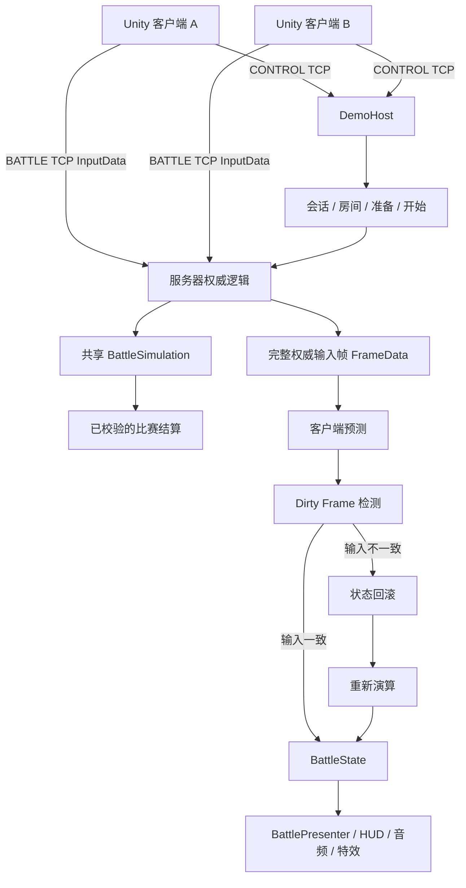
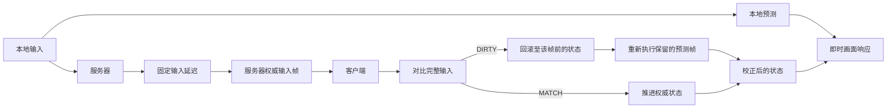
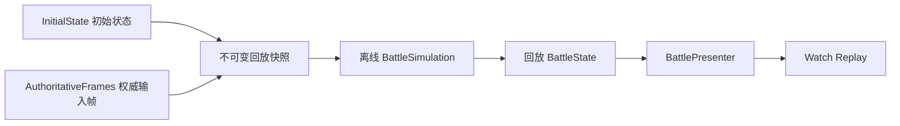

# 系统架构（Architecture）

## 运行时职责划分

两个 Unity 客户端与 .NET 服务器复用同一套纯 C# 确定性战斗模拟逻辑。表现层不负责决定伤害、碰撞、投射物生命周期、回合结果或最终比赛结算。

| 模块 | 主要职责 |
| --- | --- |
| DemoHost / CONTROL | 会话、昵称、房间、准备与开始、战斗连接接入、经过校验的结算及返回大厅。 |
| 服务器权威逻辑 / BATTLE | 玩家输入准入、固定输入延迟、完整输入帧排序与权威战斗模拟。 |
| 共享 `BattleSimulation` | 整数坐标移动、障碍物、投射物碰撞、HP、倒计时及回合/比赛规则。 |
| 客户端预测时间线 | 有界预测状态、完整输入比对、Dirty Frame 检测、回滚与重新演算。 |
| Unity 表现层 | 鼠标投影、模型朝向、动画、HUD、视觉特效/音频、调试诊断及离线回放操作。 |

## 单个逻辑 Tick 的执行过程

战斗模拟以 **30 Hz** 的固定 Tick 频率运行。本地预测输入也按该频率生成；网络消息处理则仍在每个渲染帧的 `Update` 中推进。默认输入延迟为 **2 Tick**，允许的未来输入窗口与客户端预测窗口为 **8 Tick**。服务器只发布所有玩家输入均已收齐的完整帧，**不会默默为缺失玩家补空输入**。

战斗状态使用整数逻辑坐标；Unity 表现层将 **1,000 个逻辑单位**换算为 **1 个 Unity 世界单位**。瞄准方向使用统一量化后的表示方式。障碍物和玩家命中的判定由共享确定性碰撞逻辑负责，**不依赖 Unity Physics 作为战斗权威**。场景美术与规范化的竞技场碰撞定义需要手动对齐。

## 权威帧回放（Replay）

客户端先验证比赛结算，再在销毁实时战斗运行时之前保存初始状态与服务器权威输入帧。**Watch Replay** 会启动一套新的离线模拟，不使用 BATTLE Socket，也不使用客户端预测时间线。回放每个 Tick 依次应用一帧权威输入，使用原有战斗场景呈现计算结果；CONTROL 连接仍保留，用于结算与返回大厅的业务流程。

## 状态一致性校验

`StateDigest` 对规范化的战斗状态计算摘要，包括 Tick、玩家名单（Roster）、玩家状态、投射物与比赛状态等。它是**确定性一致性检查**，不是密码学意义上的防篡改或反作弊机制。

不能把不同 Tick 的权威状态和预测状态直接做 Desync 判断；F1 调试面板会为这种比较显示 `N/A`。最终结算验证还包含权威帧回放的结果收敛校验。

临时的命中/视听反馈在表现层维护独立的对象标识缓存。在实时战斗、结算和回放之间切换时，完整的表现层重置会清理这些缓存和它创建的特效对象，**不会修改 Simulation 状态**。

对于没有权威逐 ID 命中归因的投射物移除，系统使用中立或环境命中反馈；即使恰好存在 HP 变化，也不能据此断言每个消失的投射物都命中了玩家。

## 源码依赖边界

- `Server.DemoHost` 通过实际工程引用依赖服务器的 LiveTcp、ProtocolAuthority、FrameSync，以及共享的 Simulation、Protocol 和 Stream Framing 工程。
- 客户端实时 TCP 模块组合 Prediction、Protocol、Stream Framing 与 Simulation；客户端 Demo 模块额外实现 CONTROL 业务流程。
- Unity Runtime 引用上述共享 Package，负责场景、Prefab 与表现层；离线回放播放器使用相同的 `BattleSimulation` 源码。
- Windows 构建产物在 Unity Player 旁一并包含可独立运行的 .NET 服务器，普通玩家无需安装 .NET SDK。

Unity 的场景、Prefab、材质、贴图、Shader、Resources 和脚本引用依赖 GUID。制作可移植的源码副本时，必须保留实际依赖的资源集合及其匹配的 `.meta` 文件，不能只复制竞技场中肉眼可见的对象。

相关文档：[回放与回滚](REPLAY_AND_ROLLBACK.md)、[测试与验收](TESTING.md)、[快速开始](QUICK_START.md)。
