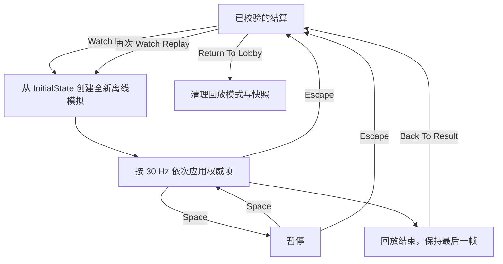

# 客户端回滚与权威回放（Replay and Rollback）

实时回滚（Rollback）与赛后回放（Replay）都基于同一套确定性模拟，但二者的**输入来源、状态来源和用途不同**。

| 对比项 | 实时回滚（Live Rollback） | 观看赛后回放（Watch Replay） |
| --- | --- | --- |
| 输入来源 | 权威帧 + 保留的预测帧 | 仅保存的服务器权威输入帧 |
| 状态来源 | 有界客户端预测时间线 | 全新创建的离线 `BattleSimulation` |
| 网络连接 | 正常使用 CONTROL 与 BATTLE | 无 BATTLE 输入/Socket；结算用 CONTROL 连接保留 |
| 主要目的 | 校正错误预测 | 重新呈现已经校验的真实对局 |

## 客户端预测与 Dirty Frame

客户端使用**完整输入帧**进行预测，并保存每次预测执行前的状态。以 **30 Hz** 采样本地输入；在尚未获得远端已校正输入时，用中立输入预测远端玩家；一旦获得可用的校正结果，则沿用最近一次已校正的远端输入继续预测。

权威状态不会超前于客户端预测时间线，预测领先范围最多 **8 Tick**。校正时比较的是权威帧与对应预测帧的**所有输入字段**，而不是仅比较最终位置。即便不同输入在地图边界限制下产生相同位置，该帧仍然属于 Dirty Frame。

如果输入一致，则正常推进权威状态；发现 Dirty Frame 时，按以下顺序处理：

1. 恢复该帧执行前保存的状态。
2. 使用共享 `BattleSimulation` 执行这一帧的服务器权威输入。
3. 重新演算尚未得到服务器确认、但已保留的后续预测帧。
4. 将校正后的预测状态交给表现层。

对于不合法的帧顺序、超出界限等情况，系统会明确报错，而不是自行编造缺失输入。

`LatestDirty` 表示最近一次校正时发现的 Dirty Frame；累计 Dirty Frame 计数统计的是**真正触发回滚的帧**，不是视觉动画被调整的次数。

## 回放快照的保存条件

必须先完成**经过验证的比赛结算**，才能提供回放。快照由原始初始状态和服务器权威帧序列的防御性只读副本组成。即使实时战斗运行时已经释放，保存的快照仍然可以使用。

如果结算尚未通过校验、快照不存在或权威帧序列为空，就不能提供 **Watch Replay** 操作。返回大厅、终止对局、退出客户端或开始新战斗，都会使旧的回放快照失效。

## 回放生命周期

回放期间不会采集移动、瞄准或开火输入。`SPACE` 和 `ESC` 在这里是回放界面操作，不属于战斗输入。回放结束后会停留在最后一帧，既不会断开有效的结算连接，也不会自动返回大厅。

再次观看时，会从最初状态重新开始。表现层完整重置将清理投射物标识缓存、重复 HP 命中反馈抑制记录、公告及已创建的视听特效，让相同的投射物 ID 能在新一遍回放中再次正确触发反馈。

从回放返回结算界面后，**Watch Replay** 与 **Return To Lobby** 仍是两个独立操作。开启下一场真实比赛时，不应残留上一场的回放模式。

## 播放速度与验证

每个回放 Tick 恰好执行一帧权威输入。正常渲染帧率下，按 `SimulationConfig.TickRate = 30` 控制播放时间；为了不跳过临时表现事件，每个渲染 `Update` **最多消耗一帧**。因此当实际渲染帧率低于 30 FPS 时，回放会变慢。

回放结束时的 Tick 与 `StateDigest` 必须和已经验证的**权威最终状态**一致。实时战斗结束时当前显示的预测状态可能领先权威状态，不能拿它作为回放终点对比。

当前 Replay **仅保存在内存中**，不支持任意跳转、调速、自由镜头、导出磁盘文件或另一套碰撞权威逻辑。相关回归测试见 [测试与验收](TESTING.md)。
