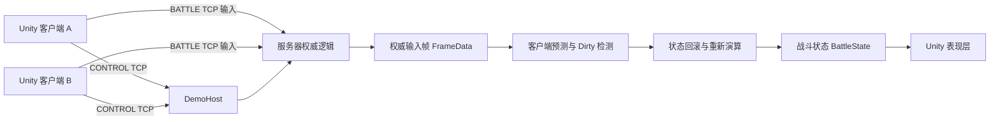

# Lockstep Arena

**确定性 1v1 局域网联机竞技场**

Unity 6 · C# · 服务器权威（Server Authority）· 输入帧同步（Input Lockstep）· 客户端预测（Client Prediction）· 回滚与重演（Rollback / Re-simulation）· 权威帧回放（Authoritative Replay）· StateDigest


> 本页展示的图片均截取自最终 Windows Player 构建版本，并非 Unity Scene View 截图或概念预览图。

## 项目简介

Lockstep Arena 是一款可实际游玩的局域网 1v1 竞技场 Demo，同时也是便于阅读和研究的多人联机实现。两名玩家可以创建或加入房间、准备并开始对战，采用三局两胜（率先赢得两回合）的规则。对局结束并通过校验后，可以利用初始状态和服务器权威输入帧，在同一套确定性战斗逻辑中重演整场比赛，而不是播放录制视频或 Transform 轨迹。

## 核心技术特性

| 技术模块 | 实现方式 |
| --- | --- |
| 确定性模拟（Deterministic Simulation） | 客户端与服务器复用独立的 C# 战斗模拟逻辑，使用整数状态和完整输入帧进行计算；Unity Physics 不负责战斗结果判定。 |
| 服务器权威输入帧同步 | 通过 CONTROL TCP 处理房间等业务流程，通过 BATTLE TCP 收集玩家输入并发布完整的服务器权威帧。 |
| 客户端预测（Client Prediction） | 本地输入可先推进有限窗口内的预测状态，使操作无需等待服务器确认后才在画面上响应。 |
| Dirty Frame 检测与回滚 | 比较预测输入和服务器权威输入；发现差异后恢复对应帧执行前的状态，并重新演算保留的后续预测帧。 |
| StateDigest 一致性校验 | 对规范化的战斗状态计算摘要，用于相同 Tick 下的状态比较，以及最终结算与回放验证。 |
| 权威帧回放（Replay） | 保留初始状态和权威输入帧，在离线模拟中重演对局，支持暂停、继续、再次播放以及返回结算界面。 |

## 系统架构



系统职责划分如下：

- **服务器：** 管理权威输入时间线和比赛结算。
- **共享战斗模拟（Simulation）：** 计算战斗规则、移动、投射物与碰撞。
- **Unity 客户端：** 负责输入采集、画面渲染、音效和 UI 展示。

完整 Tick 流程和回放数据流请查看 [架构文档](Docs/ARCHITECTURE.md)。

## 客户端预测与回滚

客户端以 **30 Tick/s（30Hz）** 的固定逻辑频率生成本地预测输入；网络收发处理则在每个渲染帧中推进，两者相互独立。

预测最多领先权威状态 **8 Tick**，与服务器允许的未来输入窗口保持一致。对于远端玩家，客户端优先沿用最近一次已校正的输入；在尚未取得可用输入时使用中立输入进行预测。

收到服务器权威帧后，客户端比较的是**完整输入帧中的各项输入**，而不仅仅是角色位置。如果发现 Dirty Frame，就恢复该帧执行前的状态，应用权威输入，并重新演算后续保留的预测帧。

在游戏中按 **F1** 可以查看权威 Tick、预测 Tick、待处理帧数、Dirty Frame 次数和 StateDigest。需要注意：**只有同一个 Tick 的状态摘要才具有直接比较意义。**

## 权威帧回放（Replay）

比赛结算通过校验后，客户端会在释放实时战斗运行时之前，保留初始状态和服务器权威帧构成的不可变回放快照。

点击游戏中的 **Watch Replay（观看回放）**，程序会创建一套新的离线战斗模拟，并复用原有战斗表现层渲染画面。此时不再采集移动、瞄准和开火等战斗输入，但结算阶段的 CONTROL TCP 连接仍然保留。

- **Space：** 暂停或继续回放。
- **Escape：** 返回当前对局的结算界面。
- **Back To Result：** 回放完成后返回结算界面。
- **再次观看：** 从初始状态重新运行，并重置投射物标识缓存、HP 反馈、公告和临时视听特效。
- **返回大厅：** 退出回放模式，并清理保存的回放快照。

详细机制参见 [回放与回滚文档](Docs/REPLAY_AND_ROLLBACK.md)。

## 调试与诊断面板

按 **F1** 打开调试面板，不会改变游戏逻辑。面板展示服务器 Tick、权威 Tick、预测 Tick、输入延迟、待处理帧、最新 Dirty Frame、累计回滚次数、同 Tick StateDigest 比较结果、回放验证状态与比赛结算状态。


## 回放画面

回放不是视频播放器，而是通过确定性模拟逐帧消费权威输入。正式版本复用了同一套竞技场表现层，并展示回放帧进度、`AUTHORITATIVE` 数据来源、`OFFLINE` 网络状态、StateDigest 以及暂停、继续和返回操作。


## 游戏流程与规则

**主菜单 → 创建/加入局域网 → 大厅 → 房间 → 准备 → 房主开始 → 战斗 → 校验后结算 → 观看回放或返回大厅**

- **WASD：** 控制移动；**鼠标：** 瞄准；**按住鼠标左键：** 连续开火；**F1：** 显示/隐藏诊断面板。
- 每名玩家初始拥有 **100 HP**，每次命中造成 **25 点伤害**。
- 每回合包含 **3 秒倒计时** 和 **60 秒战斗时间**。
- 率先赢得 **2 回合** 的玩家赢得整场比赛；平局回合不计入胜场。

## Windows 运行说明

运行时请保留完整的 `LockstepArena-Windows-x64` 文件夹，不能只复制可执行文件。发行包内含可独立运行的服务器，因此普通玩家**无需额外安装 Unity、Visual Studio 或 .NET SDK**。

1. **房主：** 运行 `LockstepArena.exe`，选择 **Create LAN（创建局域网）**，输入昵称和房间名后创建房间。程序会启动打包在一起的 DemoHost。
2. **加入者：** 在另一台电脑或同一台电脑上启动另一份客户端，选择 **Join LAN（加入局域网）**，填写不同的昵称与房主 IPv4 地址，选择房间并加入。
3. **开始游戏：** 两名玩家点击 **Ready（准备）**，然后由房主点击 **Start（开始）**。

两名玩家在同一台电脑上测试时，连接地址可以填写 `127.0.0.1`；不同电脑联机时，填写房主当前局域网 IPv4 地址。如 Windows 防火墙弹出提示，需要允许专用网络访问，并确保房主的 TCP **46000（CONTROL）** 和 **46001（BATTLE）** 端口可用。

> 当前作品定位是**局域网联机 Demo**，不是面向公网的正式联机服务。

如遇连接或运行问题，请查看 [快速开始指南](Docs/QUICK_START.md)。

## 从源码构建

开发环境要求：

- Unity `6000.3.10f1`（Unity 6.3 LTS），安装 Windows Build Support。
- .NET SDK `8.0.419`，版本由 `global.json` 固定。

使用 Unity 打开工程，进入场景 `Assets/LockstepArenaDemo/Scenes/LobbyScene.unity`。关闭正在运行的游戏客户端后，在 Unity 菜单选择：

**Lockstep Arena → Build v3-A Windows Player**

菜单名称沿用历史命名，但会构建当前保存的 Lobby/Battle 场景，并同时发布可独立运行的服务器。

完整构建产物位于 `.artifacts/V3APlayer/`，从该文件夹启动 `LockstepArena.exe`。

注意：**构建前不需要重新生成战斗表现资源。** 当前场景与机器人 Prefab 中保留了已手动调整的配置。

## 自动化测试

在仓库根目录依次执行以下 .NET 测试命令：

```powershell
dotnet run --project Tests/LockstepArena.Simulation.Tests/LockstepArena.Simulation.Tests.csproj -c Release
dotnet run --project Tests/LockstepArena.DemoFlow.Tests/LockstepArena.DemoFlow.Tests.csproj -c Release
dotnet run --project Tests/LockstepArena.Client.Prediction.Tests/LockstepArena.Client.Prediction.Tests.csproj -c Release
dotnet run --project Tests/LockstepArena.LivePrediction.Tests/LockstepArena.LivePrediction.Tests.csproj -c Release
```

上述测试请**串行执行**。Unity 内的测试可通过 Test Runner 运行：清空搜索条件，选择 **EditMode → Run All**。

各测试覆盖的逻辑、预期行为及人工验收步骤详见 [测试文档](Docs/TESTING.md)。

## 工程目录

| 路径 | 用途 |
| --- | --- |
| `Packages/com.locksteparena.*` | 共享战斗模拟、协议、TCP 消息分帧、客户端预测、实时 TCP 战斗客户端及业务流程模块。 |
| `Server/` | DemoHost、服务器权威逻辑和网络传输相关模块。 |
| `Assets/LockstepArenaDemo/` | Unity 场景、表现层 Prefab、主菜单与大厅、HUD、回放播放器及 Unity 测试。 |
| `Assets/Art/` | 选用的美术资源。 |
| `Tests/` | 可执行的 .NET 回归测试。 |
| `Docs/` | 架构、预测回滚、测试、运行指南及真实游戏截图等工程文档。 |

## 当前版本的已知限制

- **固定 1v1 竞技场：** 战斗障碍物由共享模拟中的确定性矩形数据定义，而不是通过 Unity 场景网格或 Collider 决定碰撞结果；场景视觉与逻辑碰撞区域需要手动对齐。
- **网络方案：** 使用 TCP、固定输入延迟和严格完整输入帧；某玩家输入缺失会阻塞后续权威帧发布，不提供自动补空输入或断线重连。
- **公网服务：** 未实现正式账号系统、互联网匹配、TLS 或面向生产环境的网络安全加固。
- **表现平滑：** 远端角色仍有轻微视觉抖动，尚未加入插值层。
- **回放能力：** 当前仅在内存中保存，尚无任意跳转、倍速、磁盘回放文件等功能；渲染帧率低于 30 FPS 时，回放会放慢，而不是跳过需要表现的逻辑帧。
- **状态摘要：** StateDigest 用于状态一致性检查，**不属于密码学意义上的反作弊机制**。
- **命中反馈：** 投射物被移除时没有完整的权威逐 ID 命中归因；无法明确判断的移除会使用中立/环境反馈，而不是一律视为命中玩家，HP 下降反馈单独处理。

## 第三方资源与许可证

- 机器人角色：[Styloo](https://styloo.itch.io/robot-character)
- 场景、道具与武器：[Quaternius](https://quaternius.com/)
- UI、粒子与音效：[Kenney](https://kenney.nl/)

选用的美术素材采用 **CC0**；工程中包含的 **Liberation Sans** 字体使用 **SIL OFL 1.1**；**Google.Protobuf** 使用 **BSD-3-Clause**。Windows 系统已安装的字体仅在运行时使用，不会随项目重新分发。

更多细节请查看 [第三方许可证声明](THIRD_PARTY_LICENSES.txt) 和 Windows 发行包内的相关说明。第三方素材的许可证**不代表**其他工程代码也自动采用相同许可证。

## 工程技术文档

- [系统架构（Architecture）](Docs/ARCHITECTURE.md)
- [回放与回滚（Replay and Rollback）](Docs/REPLAY_AND_ROLLBACK.md)
- [测试与验收（Testing）](Docs/TESTING.md)
- [快速开始（Quick Start）](Docs/QUICK_START.md)
